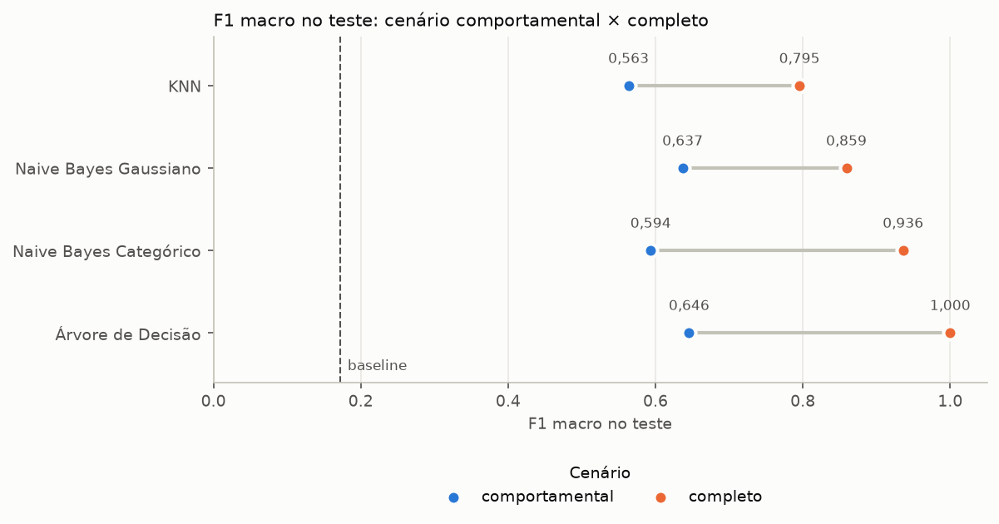
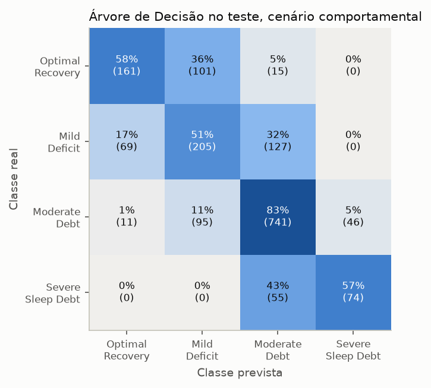
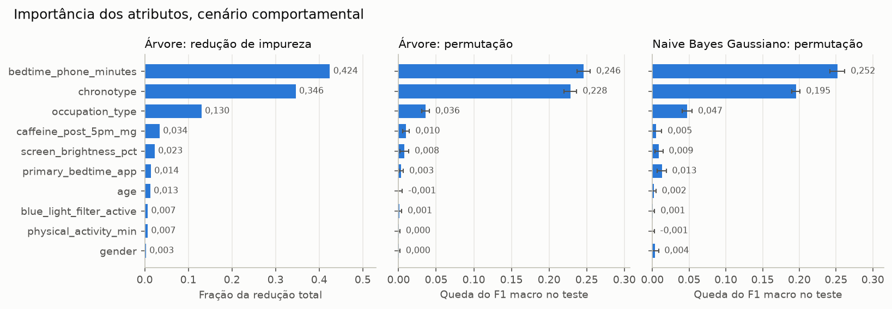
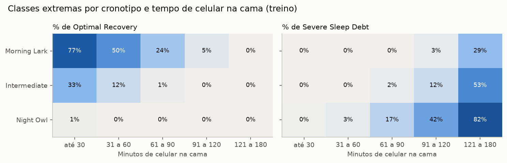

# Impacto do Tempo de Tela no Sono


[](LICENSE)
[](https://creativecommons.org/licenses/by-sa/4.0/)

Projeto de **mineração de dados** que investiga como os hábitos de uso do celular antes de dormir se relacionam com a qualidade do sono, e constrói modelos de classificação para **prever a categoria de débito de sono** de uma pessoa.

> Projeto feito em dupla durante a disciplina de Mineração de Dados.

## 🎯 Objetivo

Prever a variável alvo **`sleep_debt_category`** a partir de atributos demográficos, de rotina e de uso de telas, comparando três algoritmos de classificação:

- **K-Nearest Neighbors (KNN)**
- **Naive Bayes** (Gaussiano e Categórico)
- **Árvore de Decisão**

### Cenários de atributos

A etapa de validação mostrou que o alvo é reproduzido com 100% de acerto por uma regra simples sobre `total_sleep_hours` e `next_day_fatigue_score`, ou seja, essas colunas vazam a resposta (*data leakage*). Por isso, cada modelo é treinado em dois cenários, definidos pelo momento em que cada informação é obtida (ver o [dicionário](#dicionário-de-variáveis)):

| Cenário | Atributos | Papel |
|---|---|---|
| **Comportamental** | As 10 colunas de **perfil** e **antes de dormir** | **Principal.** Usa só o que se conhece antes da noite de sono e responde à pergunta do projeto |
| **Completo** | As 16 colunas, exceto o identificador e o alvo | **Comparação.** Inclui as medidas do sono e do dia seguinte, para medir o efeito do vazamento |

### Classes da variável alvo

| Classe | Significado | Registros | % |
|---|---|---:|---:|
| `Optimal Recovery` | Sono reparador, sem débito | 1.387 | 16,3% |
| `Mild Deficit` | Débito leve | 2.004 | 23,6% |
| `Moderate Debt` | Débito moderado | 4.462 | 52,5% |
| `Severe Sleep Debt` | Débito severo | 647 | 7,6% |

As classes são **ordenadas** (de melhor para pior) e **desbalanceadas**. Mais da metade dos registros está em `Moderate Debt`, o que influencia a separação treino/teste (estratificação) e a escolha das métricas de avaliação.

## 📊 Conjunto de dados

- **Fonte:** [Sleep Debt & Screen Time: Late Night Phone Habits](https://www.kaggle.com/datasets/samartalwar/sleep-debt-and-screen-time-late-night-phone-habits) (Kaggle), por [Samar Talwar](https://www.kaggle.com/samartalwar)
- **Licença:** [CC BY-SA 4.0](https://creativecommons.org/licenses/by-sa/4.0/)
- **Tamanho:** 8.500 registros × 18 colunas
- **Natureza:** dados **sintéticos**, gerados por uma simulação baseada em relações biofísicas (supressão de melatonina pelo brilho e pelo tempo de tela, atenuada pelo filtro de luz azul, e diferentes níveis de estímulo para cada tipo de app). Por isso, as conclusões refletem as regras da simulação, não necessariamente o comportamento de pessoas reais.

### Dicionário de variáveis

A coluna **Momento** indica quando a informação é obtida em relação à noite de sono. Isso importa porque atributos medidos *durante* o sono ou *no dia seguinte* podem conter informação da própria resposta (*data leakage*). Por isso, eles entram apenas no cenário **completo** (ver [cenários de atributos](#cenários-de-atributos)). O próprio autor do dataset sugere priorizar os atributos comportamentais (cafeína, app, tempo de tela) em vez das medidas fisiológicas.

| Variável | Tipo | Descrição | Domínio | Momento |
|---|---|---|---|---|
| `user_id` | Identificador | Identificador alfanumérico único de cada participante | `USR-00001` … | — |
| `age` | Numérico (inteiro) | Idade do participante em anos (concentrada na faixa de 18 a 45) | 18 – 65 | Perfil |
| `gender` | Categórico nominal | Identidade de gênero autodeclarada | `Female`, `Male`, `Non-Binary` | Perfil |
| `occupation_type` | Categórico nominal | Categoria geral de ocupação, que influencia a obrigação de horário para acordar | `Corporate 9-to-5`, `Remote Tech`, `Student`, `Healthcare / Shift Worker`, `Freelance / Creative` | Perfil |
| `chronotype` | Categórico ordinal | Preferência circadiana biológica (cronotipo) | `Morning Lark`, `Intermediate`, `Night Owl` | Perfil |
| `bedtime_phone_minutes` | Numérico (inteiro) | Total de minutos de uso ativo do celular na cama antes de tentar dormir | 1 – 180 | Antes de dormir |
| `primary_bedtime_app` | Categórico nominal | Categoria de aplicativo mais usada durante o uso do celular na cama | `TikTok / Reels`, `YouTube`, `Instagram / Reddit`, `Streaming (Netflix/Hulu)`, `Messaging / Chat`, `News / Reading` | Antes de dormir |
| `screen_brightness_pct` | Numérico (inteiro) | Brilho da tela configurado no aparelho, em porcentagem | 10 – 100 | Antes de dormir |
| `blue_light_filter_active` | Binário | Indica se o filtro de luz azul (tons quentes) estava ativo | 1 = ativo, 0 = inativo | Antes de dormir |
| `caffeine_post_5pm_mg` | Numérico (inteiro) | Estimativa de cafeína consumida após as 17h (mg) | 0 – 250 | Antes de dormir |
| `physical_activity_min` | Numérico (inteiro) | Total de minutos de exercício físico intencional feito mais cedo no mesmo dia | 0 – 112 | Antes de dormir |
| `sleep_latency_min` | Numérico (contínuo) | Estimativa de minutos para adormecer depois de largar o aparelho | 6 – 123,3 | Durante o sono |
| `total_sleep_hours` | Numérico (contínuo) | Total de horas de sono calculado até o despertador tocar | 3,2 – 9,8 | Durante o sono |
| `deep_sleep_pct` | Numérico (contínuo) | Estimativa da % do sono total em sono profundo (ondas lentas) | 8,1 – 28 | Durante o sono |
| `rem_sleep_pct` | Numérico (contínuo) | Estimativa da % do sono total na fase REM (*Rapid Eye Movement*) | 9,6 – 27 | Durante o sono |
| `morning_alarm_snoozes` | Numérico (inteiro) | Número de vezes que o participante adiou o despertador pela manhã | 0 – 7 | Dia seguinte |
| `next_day_fatigue_score` | Numérico (contínuo) | Cansaço subjetivo no dia seguinte, em escala de 1,0 a 10,0. É o alvo de regressão sugerido pelo autor, e aqui é usado apenas como atributo, no cenário completo | 1 – 10 | Dia seguinte |
| **`sleep_debt_category`** | **Categórico ordinal (alvo)** | **Alvo multiclasse que define a gravidade do débito de sono** | ver [classes](#classes-da-variável-alvo) | Alvo |

> As descrições seguem a documentação das colunas publicada pelo autor no Kaggle. Os domínios foram observados nos dados brutos e confirmados na etapa de validação.

## 🔄 Etapas do projeto

### 1. Validação dos dados
Auditoria da base bruta, **sem alterar os dados**. Verifica os tipos de cada atributo, os valores ausentes por coluna, as duplicatas, os valores mal formatados (ex.: espaços extras, variações de escrita), os valores fora do domínio esperado (ex.: horas negativas) e a consistência entre colunas. Também analisa a cardinalidade das categóricas, a distribuição da variável alvo e possíveis vazamentos de informação.

### 2. Limpeza dos dados
Aplica as correções **determinísticas** encontradas na validação: padronizar a formatação, remover duplicatas, ajustar os tipos e tratar os valores impossíveis. A base limpa é salva em `data/processed/`.

### 3. Separação treino/teste
Divide a base limpa em treino e teste, com **estratificação** pela variável alvo por causa do desbalanceamento das classes. A partir daqui, o conjunto de teste só é usado na avaliação final.

### 4. Análise exploratória (EDA)
Feita **apenas no conjunto de treino**: olhar o teste e tomar decisões com base nele também seria uma forma de vazamento de informação, mesmo sem nenhum código. Inclui as distribuições dos atributos, a identificação e análise de outliers, as correlações entre variáveis numéricas e categóricas e a relação de cada atributo com a variável alvo, com visualizações gráficas. As conclusões guiam as decisões de pré-processamento.

### 5. Pré-processamento
Transformações que **aprendem com os dados** (imputação, tratamento de outliers, codificação, normalização, discretização, redução de dimensionalidade). Ficam encapsuladas em *pipelines* do scikit-learn, ajustados somente no treino para evitar *data leakage*. Cada algoritmo tem o seu próprio pré-processamento, já que eles têm necessidades diferentes (ex.: o KNN exige normalização, a árvore de decisão não).

### 6. Modelagem e validação
Treina os três classificadores e um *baseline* nos dois [cenários de atributos](#cenários-de-atributos). Usa **validação cruzada estratificada com 10 folds** no treino, os mesmos para todos os modelos, para comparar os modelos e ajustar os hiperparâmetros (escolhidos pelo F1 macro), e faz a avaliação final no conjunto de teste (*holdout*). O Naive Bayes é testado em duas versões, Gaussiano e Categórico, e a árvore com as categorias em códigos inteiros ou em one-hot. As métricas são a acurácia, a acurácia balanceada, o F1 macro e a matriz de confusão. A diferença entre os cenários mostra quanto do desempenho vem do vazamento de informação.

### 7. Resultados
Compara o desempenho dos modelos nos dois cenários, analisa os erros e os atributos mais importantes (importância da árvore e importância por permutação) e apresenta as conclusões e limitações do estudo. Os modelos são recriados a partir dos hiperparâmetros salvos na etapa 6, sem repetir a busca.

## 📈 Resultados

Métricas no conjunto de teste, depois de os hiperparâmetros serem escolhidos por validação cruzada no treino. Os valores completos, com a média e o desvio da validação cruzada, estão em [`reports/metrics/resultados.csv`](reports/metrics/resultados.csv).

**Cenário comportamental (principal)**

| Modelo | Acurácia | Acurácia balanceada | F1 (macro) |
|---|---:|---:|---:|
| Baseline | 0,525 | 0,250 | 0,172 |
| KNN | 0,648 | 0,533 | 0,563 |
| Naive Bayes Gaussiano | 0,701 | **0,625** | 0,637 |
| Naive Bayes Categórico | 0,690 | 0,553 | 0,594 |
| Árvore de Decisão | **0,713** | 0,623 | **0,646** |

**Cenário completo (comparação)**

| Modelo | Acurácia | Acurácia balanceada | F1 (macro) |
|---|---:|---:|---:|
| Baseline | 0,525 | 0,250 | 0,172 |
| KNN | 0,830 | 0,770 | 0,795 |
| Naive Bayes Gaussiano | 0,870 | 0,899 | 0,859 |
| Naive Bayes Categórico | 0,956 | 0,961 | 0,936 |
| Árvore de Decisão | **1,000** | **1,000** | **1,000** |



- **No cenário comportamental, a árvore de decisão e o Naive Bayes Gaussiano têm desempenhos próximos** (F1 macro de 0,646 e 0,637 no teste). Na validação cruzada, a árvore ficou à frente (0,646 × 0,613), em um único experimento, sem teste estatístico. Os dois acertam cerca de 70% dos registros, contra 52,5% do baseline, que sempre prevê `Moderate Debt`.
- **O cenário completo mostra o vazamento:** com as horas de sono e a fadiga do dia seguinte, a árvore acerta 100%, porque o alvo é definido a partir dessas colunas.
- **O teste ficou próximo da validação cruzada**, com diferenças de no máximo 0,023 no F1 macro.
- **A árvore usa one-hot nas categorias.** Com códigos inteiros, a ordem alfabética das categorias influenciava as divisões da árvore (F1 macro de 0,632 na validação cruzada). A codificação foi escolhida pela validação cruzada (ver [limitações](#limitações)).

### Onde os modelos erram



95% dos erros da árvore ficam entre classes vizinhas, e nenhum registro de `Optimal Recovery` ou `Mild Deficit` é confundido com `Severe Sleep Debt`. `Mild Deficit`, entre o sono reparador e o débito moderado, é a classe com menos acertos (46%). A identificação dos casos de `Severe Sleep Debt` ainda é limitada: a árvore encontra metade deles, e o restante é previsto como `Moderate Debt`.

### Atributos mais importantes



Os **minutos de celular na cama** e o **cronotipo** dominam a previsão, tanto na árvore quanto no Naive Bayes Gaussiano. A ocupação vem em terceiro, por causa dos profissionais de saúde e de turnos. Nestes modelos, brilho da tela, filtro de luz azul, tipo de aplicativo e cafeína pouco acrescentam quando esses atributos já são conhecidos; isso descreve a contribuição deles para a previsão, não a ausência de efeito sobre o sono.



Os dois efeitos se somam. No treino, 77% dos registros de pessoas matutinas (`Morning Lark`) que usam o celular por até 30 minutos têm sono reparador, e 82% dos de pessoas vespertinas (`Night Owl`) que passam mais de 2 horas no celular estão em débito severo.

### Conclusões

- **Os hábitos antes de dormir permitem prever a categoria de débito de sono bem acima do acaso**, mas não com precisão: cerca de 70% de acerto no teste, com erros quase sempre de um nível.
- **Nos modelos avaliados, o que mais pesa é o tempo de celular na cama combinado com o cronotipo.** O mesmo tempo de tela está associado a resultados diferentes em quem é matutino e em quem é vespertino.
- **A identificação do débito severo ainda é limitada** só com os hábitos: metade dos casos é identificada.
- **A árvore de decisão e o Naive Bayes Gaussiano têm desempenhos próximos**, e a árvore ainda é fácil de interpretar. O KNN fica atrás; com só os três atributos principais, ele sobe de 0,578 para 0,638 de F1 macro na validação cruzada, em um teste exploratório, o que sugere que os atributos pouco informativos atrapalham as distâncias.

### Limitações

- **Dados sintéticos:** os resultados refletem as regras da simulação que gerou a base, não necessariamente o comportamento de pessoas reais.
- **Associação, não causa:** os modelos mostram quais hábitos acompanham o débito de sono, não que mudar um hábito muda o sono. A importância dos atributos também é específica dos modelos avaliados.
- **Uso do teste:** a codificação one-hot da árvore foi incluída depois de o teste já ter sido usado uma vez (com códigos inteiros, a árvore tinha F1 macro de 0,634 no teste). Ela foi escolhida só pela validação cruzada, mas, a rigor, o teste deixou de ser totalmente independente das decisões.
- **Vazamento investigado na base inteira:** a regra que reproduz o alvo foi encontrada na etapa 1, antes da separação treino/teste. Isso não afeta o cenário principal, cujas colunas foram escolhidas pelo momento da coleta, mas o mais rigoroso seria fazer essa investigação só no treino.
- **Uma noite por pessoa:** não dá para separar os hábitos de um dia dos hábitos de costume.
- **O alvo é definido pelas horas de sono e pela fadiga**, que os hábitos antes de dormir explicam só em parte; isso limita o cenário comportamental, principalmente no débito severo.

## 📁 Estrutura do repositório

```
scroll-antes-de-dormir/
├── data/
│   ├── raw/          # dados originais, sem alterações
│   └── processed/    # dados limpos e divididos
├── notebooks/        # notebooks de cada etapa do projeto
├── src/
│   └── scroll_sono/  # pacote com o código reutilizável
├── reports/
│   ├── figures/      # gráficos gerados
│   └── metrics/      # métricas dos modelos
├── pyproject.toml
├── uv.lock
├── LICENSE
└── README.md
```

## 🛠️ Tecnologias

- **Python 3.12+**
- **[uv](https://docs.astral.sh/uv/):** gerenciamento do ambiente e das dependências
- **Jupyter:** notebooks de análise
- **pandas / NumPy:** manipulação dos dados
- **scikit-learn:** pré-processamento, modelos e validação
- **Matplotlib / Seaborn:** visualização

## ⚙️ Preparação do ambiente

### 1. Instalar o uv

```bash
# Linux / macOS
curl -LsSf https://astral.sh/uv/install.sh | sh

# Windows (PowerShell)
powershell -ExecutionPolicy ByPass -c "irm https://astral.sh/uv/install.ps1 | iex"
```

### 2. Clonar o repositório e instalar as dependências

```bash
git clone https://github.com/diogovcastro/scroll-antes-de-dormir.git
cd scroll-antes-de-dormir
uv sync
```

O `uv sync` cria o ambiente virtual (`.venv`) e instala exatamente as versões registradas no `uv.lock`. Se a versão do Python exigida não estiver instalada, o uv baixa ela automaticamente. O código de `src/` também é instalado, como o pacote `scroll_sono`, e pode ser importado nos notebooks (`from scroll_sono import ...`).

### 3. Abrir os notebooks

```bash
uv run jupyter lab
```

Execute os notebooks na ordem numérica.

## 👥 Autores

- Diogo Vieira ([@diogovcastro](https://github.com/diogovcastro))
- [@LemonCandles](https://github.com/LemonCandles)

## 📄 Licença

- **Código:** [MIT](LICENSE)
- **Dados:** o conjunto de dados [Sleep Debt & Screen Time: Late Night Phone Habits](https://www.kaggle.com/datasets/samartalwar/sleep-debt-and-screen-time-late-night-phone-habits), de [Samar Talwar](https://www.kaggle.com/samartalwar), é distribuído sob a licença [Creative Commons Attribution-ShareAlike 4.0 (CC BY-SA 4.0)](https://creativecommons.org/licenses/by-sa/4.0/). Os dados em `data/processed/` são derivados do original (limpeza e divisão em treino/teste) e são distribuídos sob a mesma licença CC BY-SA 4.0.
